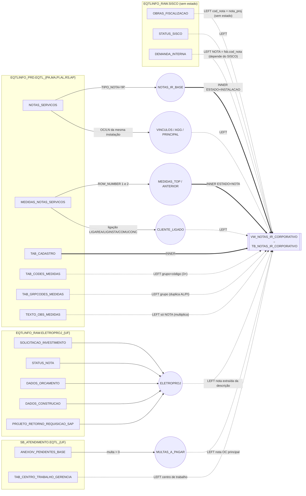

# Mapeamento Snowflake — `TB_NOTAS_IR_CORPORATIVO`

> **Engenharia reversa e validação da principal fonte de dados da Central de Soluções de Incorporação de Redes.**
> Data: 14/11/2026 · Conta `CFGKDTB-ISB76799` · Role `GRP_SWF_TATICO_PA` · Warehouse `WH_EQTLINFO` (X-Small)
>
> **Somente leitura.** Todas as consultas foram `SELECT`, `WITH … SELECT` ou `SHOW`, com bloqueio automático
> de qualquer comando de escrita antes do envio ao servidor. Nada foi alterado no Snowflake. A integração com
> o Django **não foi iniciada**.
>
> **Como ler este documento.** Cada afirmação é marcada como:
> **[FATO]** comprovado pelo SQL ou medido nos dados · **[HIPÓTESE]** depende de validação do negócio ·
> **[RECOMENDAÇÃO]** sugestão técnica, não aplicada.

---

## Índice

0. [Resumo executivo](#0-resumo-executivo)
1. [Diagrama da arquitetura das fontes](#1-diagrama-da-arquitetura-das-fontes)
2. [Inventário completo das tabelas](#2-inventário-completo-das-tabelas)
3. [Linhagem das 85 colunas](#3-linhagem-das-85-colunas)
4. [Mapa dos relacionamentos (JOINs)](#4-mapa-dos-relacionamentos-joins)
5. [Cardinalidades verificadas](#5-cardinalidades-verificadas)
6. [Regras de negócio](#6-regras-de-negócio)
7. [Problemas encontrados](#7-problemas-encontrados)
8. [Dúvidas que precisam de decisão humana](#8-dúvidas-que-precisam-de-decisão-humana)
9. [Recomendações para integração com Django](#9-recomendações-para-integração-com-django)
10. [Amostra controlada](#10-amostra-controlada)
11. [Outras tabelas encontradas e método](#11-outras-tabelas-encontradas-e-método)

---

## 0. Resumo executivo

1. **[FATO] A query de construção é a view `SB_TATICO_PA.OBRAS.VW_NOTAS_IR_CORPORATIVO`** (840 linhas de SQL).
   Ela tem exatamente as mesmas 85 colunas, na mesma ordem, da tabela `TB_NOTAS_IR_CORPORATIVO`, que é a sua
   materialização (última carga: **13/11/2026 11:36 (horário do Pacífico)**; a view foi alterada em 12/11/2026).
2. **[FATO] A view é inviável para leitura direta**: até um `SELECT … LIMIT 10` passou de 120 s e foi cancelado.
   Toda leitura deve ser feita na tabela materializada.
3. **[FATO] A tabela NÃO tem uma linha por nota IR.** São **9.756 linhas para 3.503 notas** (1.215 notas repetidas,
   até 278 linhas para uma única nota; 4.227 linhas são cópias idênticas de outras). A multiplicação foi
   reproduzida pelos dados das fontes com precisão de 99,2% das notas, e vem de **quatro JOINs**:
   `TEXTO_OBS_MEDIDAS` (+4.472 linhas; 707 notas), `TAB_GRPCODES_MEDIDAS` duplicada em AL e PI (420 notas),
   `DEMANDA_INTERNA` (250 notas) e `OBRAS_FISCALIZACAO` (5 notas).
4. **[FATO] Os INNER JOINs eliminam 182 das 3.685 notas IR** existentes nas fontes (4,9%): 181 por falta de
   cadastro da instalação (**132 só no RS = 44% das notas IR do RS**) e 1 por não ter medida.
5. **[FATO] Integração Eletroproj por texto livre**: a nota IR é localizada procurando um número de 10 dígitos
   dentro de `SLI_DESC_OBRA`. Cobre 54,3% das notas. Nenhuma nota IR casa pelo campo estruturado `SLI_NOTA_SAP`.
6. **[FATO] Colunas sem informação útil hoje**: `CLIENTE_LIGADO_NOTA_IR` é sempre `'NÃO'`,
   `DATA_ENERGIZACAO_NOTA_IR` é sempre nula, `MULTA`/`PRAZO_ANEXOIV` estão preenchidas em 1 nota de 3.503 e
   `QTD_CLIENTES_LIGADOS` é sempre igual a `QTD_NOTAS_VINCULADAS_LIGADAS`.
7. **[FATO] A medida atual é bem definida**: nenhum empate na ordenação em 3.684 notas; só 1 nota (PI) tem a medida
   atual encerrada com outra ainda aberta e só 1 nota (PI) tem como atual uma medida que não é a de maior número.
8. **[FATO] Consolidação de 6 estados (PA, MA, PI, AL, RS, AP). Goiás não existe nas fontes.**
9. **[FATO] Todas as 81 tabelas físicas** (13 fontes × 6 estados + 3 do SISCO) estão acessíveis com a role atual.

**Tabelas realmente necessárias para o sistema:** a leitura do Django deve usar **apenas**
`SB_TATICO_PA.OBRAS.TB_NOTAS_IR_CORPORATIVO` (após decidir o tratamento das duplicidades — §8). As 16 fontes
da §2 são necessárias para **reconstruir ou corrigir** a tabela no Snowflake, não para leitura direta pelo
Django. As demais tabelas de `SB_TATICO_PA.OBRAS` parecem versões anteriores só do PA (§11) e não são necessárias.

---

## 1. Diagrama da arquitetura das fontes

Legenda: linha dupla = `INNER JOIN` (elimina notas); pontilhada = `LEFT JOIN` (preserva notas, pode multiplicar).

---

## 2. Inventário completo das tabelas

**[FATO]** Todas as tabelas abaixo existem e foram lidas com a role `GRP_SWF_TATICO_PA`. Volumes de 14/11/2026.
As fontes por estado são unidas com `UNION ALL BY NAME`, acrescentando a coluna literal `ESTADO`.

| Database.schema | Tabela | PA | MA | PI | AL | RS | AP | Atualizada (PA) | Finalidade | Colunas usadas |
|---|---|---:|---:|---:|---:|---:|---:|---|---|---|
| `EQTLINFO_PRD.EQTL_{UF}` | `NOTAS_SERVICOS` | 142.223.183 | 117.633.964 | 68.556.740 | 61.132.436 | 509.858.914 | 16.348.341 | 2026-11-14 | Notas de serviço SAP/CCS; base das notas IR e das OC/LN vinculadas | NOTA, TIPO_NOTA, INSTALACAO, TEXTO_BREVE, GRUPO_CODES, CODIFICACAO, STATUS_CCS, CENTRO_TRABALHO, AREA_ESTRUT_REGIONAL, CARTEIRA_CLIENTE, DATA_CRIACAO, INICIO_DESEJADO, FIM_DESEJADO, INICIO_AVARIA, DATA_ALTERACAO, DATA_ENCERRAMENTO |
| `EQTLINFO_PRD.EQTL_{UF}` | `MEDIDAS_NOTAS_SERVICOS` | 209.362.212 | 152.386.979 | 28.932.853 | 30.817.028 | 5.407.559 | 3.269.470 | 2026-11-14 | Medidas (atividades) das notas: medida atual/anterior e regra de ligação | NOTA, MEDIDA, GRUPO_MEDIDA, CODIGO_MEDIDA, DATA_CRIACAO_MEDIDA, DATA_CONCLUSAO_MEDIDA, DATA_DADOS, DATA_ENCERRAMENTO_NOTA, CONCLUIDO_POR, INICIO_PROGRAMADO_MEDIDA, FIM_PROGRAMADO_MEDIDA |
| `EQTLINFO_PRD.EQTL_{UF}` | `TAB_CADASTRO` | 4.868.699 | 4.198.590 | 1.996.559 | 1.746.526 | 2.364.767 | 348.593 | 2026-11-14 | Cadastro da instalação/cliente (endereço, regional, conta contrato) | INSTALACAO, CONTA_CONTRATO, REGIONAL, MUNICIPIO, BAIRRO, PERIMETRO, NOME, ENDERECO, LATITUDE, LONGITUDE |
| `EQTLINFO_PRD.EQTL_{UF}` | `TAB_CODES_MEDIDAS` | 8.283 | 8.274 | 8.316 | 8.319 | 13.428 | 13.092 | 2026-11-14 | Descrição dos códigos de medida | GRUPO_CODIGO, CODIGO, TEXTO_BREVE_CODIGO |
| `EQTLINFO_PRD.EQTL_{UF}` | `TAB_GRPCODES_MEDIDAS` | 2.129 | 2.131 | 5.512 | 5.512 | 2.167 | 2.266 | 2026-11-14 | Descrição dos grupos de medida | GRUPO_CODIGO, TEXTO_BREVE_GRUPO_CODIGO |
| `EQTLINFO_PRD.EQTL_{UF}` | `TEXTO_OBS_MEDIDAS` | 25.049.081 | 24.440.405 | 47.370.967 | 39.507.749 | 1.063.176 | 438.109 | 2026-11-14 | Textos de observação das medidas | NOTA, TEXTO |
| `EQTLINFO_RAW.ELETROPROJ_{UF}` | `SOLICITACAO_INVESTIMENTO` | 162.882 | 213.738 | 103.598 | 60.061 | 17.083 | 2.853 | 2026-11-13 | Solicitação de investimento (projeto) do Eletroproj | SLI_ID, SLI_NOTA_SAP, SLI_DESC_OBRA, SLI_SOLICITANTE, SLI_STATUS_NOTA |
| `EQTLINFO_RAW.ELETROPROJ_{UF}` | `STATUS_NOTA` | 31 | 32 | 31 | 31 | 31 | 31 | 2026-11-13 | Status do projeto (SGO/SAP/PROJ) | ID_STATUS_NOTA, DESC_STATUS_NOTA, SAP_STATUS_NOTA, PROJ_STATUS_NOTA |
| `EQTLINFO_RAW.ELETROPROJ_{UF}` | `DADOS_ORCAMENTO` | 145.469 | 183.578 | 91.633 | 56.530 | 13.739 | 2.313 | 2026-11-13 | Orçamento do projeto | SLI_ID, VL_MATERIAL_TOTAL, VL_MO_TOTAL, VL_TOTAL_ORCAMENTO |
| `EQTLINFO_RAW.ELETROPROJ_{UF}` | `DADOS_CONSTRUCAO` | 90.070 | 117.631 | 48.427 | 32.733 | 7.914 | 457 | 2026-11-13 | Dados de construção (PEP nível 3) | SLI_ID, ELEMENTO_PEP_NIVEL3 |
| `EQTLINFO_RAW.ELETROPROJ_{UF}` | `PROJETO_RETORNO_REQUISICAO_SAP` | 8.686.492 | 10.328.423 | 3.963.886 | 3.908.540 | 609.706 | 142.541 | 2026-11-13 | Retorno de requisições SAP (PEP de incorporação `.I`) | NOTA, PEP_NV_4 |
| `SB_ATENDIMENTO.EQTL_{UF}` | `ANEXOIV_PENDENTES_BASE` | 29.180 | 32.560 | 20.184 | 6.788 | 8.858 | 1.897 | 2026-11-13 | Pendências do Anexo IV (prazos e multas regulatórias) | NOTA, VALOR_MULTA_EUSD_M, PRAZO |
| `SB_ATENDIMENTO.EQTL_{UF}` | `TAB_CENTRO_TRABALHO_GERENCIA` | 158 | 311 | 131 | 99 | 130 | 102 | 2025-04-26 | DE-PARA centro de trabalho → gerência | CENTRO_TRABALHO, GERENCIA |
| `EQTLINFO_RAW.SISCO` | `OBRAS_FISCALIZACAO` | 443.568 | (única) | (única) | (única) | (única) | (única) | 2026-11-13 | Fiscalização de obras (SISCO) — **sem estado no JOIN** | COD_NOTA, STATUS_SISCO_FISCALIZACAO_ID, DATA_AGENDAMENTO, DATA_ATRIBUICAO_FISCAL, DATA_DA_FISCALIZACAO, DATA_PREVISAO_ENTREGA, DATA_SOLICITACAO, DURACAO_DIAS, DATA_DEVOLUCAO, DATA_CONCLUSAO, DATA_ENTREGA_RELATORIO_CAMPO |
| `EQTLINFO_RAW.SISCO` | `STATUS_SISCO` | 77 | (única) | (única) | (única) | (única) | (única) | 2026-11-13 | Descrição dos status do SISCO | STATUS_ID, DESCRICAO |
| `EQTLINFO_RAW.SISCO` | `DEMANDA_INTERNA` | 139.982 | (única) | (única) | (única) | (única) | (única) | 2026-11-13 | Demandas internas do SISCO | NOTA, SITUACAO_DEM_ID, DATA_ABERTURA_SOLIC, DESCRICAO_SOLICITACAO, NOME_ANALISTA_SOLIC |

Destino: `SB_TATICO_PA.OBRAS.TB_NOTAS_IR_CORPORATIVO` (tabela, 85 colunas, 9.756 linhas, 1,6 MB, carga 13/11/2026) materializada a partir de `SB_TATICO_PA.OBRAS.VW_NOTAS_IR_CORPORATIVO` (view).

---

## 3. Linhagem das 85 colunas

Legenda dos apelidos (aliases) usados na query:

| Apelido | Origem | Tipo de JOIN na consulta final |
|---|---|---|
| `tab1` | `NOTAS_IR_BASE` = `NOTAS_SERVICOS` (6 estados) com `TIPO_NOTA = 'IR'` | base (FROM) |
| `cad` | `TAB_CADASTRO` (6 estados) por `ESTADO + INSTALACAO` | **INNER** |
| `med` | `MEDIDAS_TOP` = `MEDIDAS_NOTAS_SERVICOS` com `ROW_NUMBER() = 1` por `ESTADO, NOTA` | **INNER** |
| `med_ant` | `MEDIDAS_ANTERIOR` = mesmo ranking, posição 2 | LEFT |
| `tab4` / `tab4_ant` / `tcm` | `TAB_CODES_MEDIDAS` por `ESTADO + GRUPO_CODIGO + CODIGO` | LEFT (o `tcm` não é usado no SELECT) |
| `tgm` | `TAB_GRPCODES_MEDIDAS` por `ESTADO + GRUPO_CODIGO` | LEFT |
| `texto_ant` | `TEXTO_OBS_MEDIDAS` por `ESTADO + NOTA` (**sem MEDIDA**) | LEFT |
| `ctg` | `TAB_CENTRO_TRABALHO_GERENCIA` por `ESTADO + CENTRO_TRABALHO` | LEFT |
| `ep` | CTE `ELETROPROJ` (SOLICITACAO_INVESTIMENTO + STATUS_NOTA + DADOS_ORCAMENTO + DADOS_CONSTRUCAO + PROJETO_RETORNO_REQUISICAO_SAP), 1 linha por `ESTADO + nota_ccs_sgo` | LEFT |
| `fsb` | `EQTLINFO_RAW.SISCO.OBRAS_FISCALIZACAO` por `cod_nota = ep.nota_proj` (**sem estado**) | LEFT |
| `status_fisc` | `SISCO.STATUS_SISCO` por `status_id = fsb.status_sisco_fiscalizacao_id` | LEFT |
| `di` | `SISCO.DEMANDA_INTERNA` por `NOTA = fsb.cod_nota` (**depende de fsb**) | LEFT |
| `status_di` | `SISCO.STATUS_SISCO` por `status_id = di.situacao_dem_id` | LEFT |
| `va` | CTE `VINCULOS_AGG` (1 linha por `ESTADO + NOTA_IR`) | LEFT |
| `vp` | CTE `VINCULO_PRINCIPAL` (vínculo OC/LN mais recente) | LEFT |
| `lig` | CTE `CLIENTE_LIGADO` da nota vinculada principal (`vp.NOTA_VINCULADA`) | LEFT |
| `cl_ir` | CTE `CLIENTE_LIGADO` da própria nota IR | LEFT |
| `mf` | CTE `MULTAS_A_PAGAR` (`ANEXOIV_PENDENTES_BASE` com multa > 0) da nota vinculada principal | LEFT |

Obrigatoriedade: **Sempre** = nunca nulo por construção (base, `INNER JOIN` ou `COALESCE` com padrão);
**Linha garantida** = a linha de origem existe (INNER), mas o valor da coluna pode ser nulo na fonte;
**Opcional** = vem de `LEFT JOIN` e fica nulo quando não há correspondência. Cobertura medida na §5.

| # | Coluna de saída | Tipo | Origem (apelido.coluna) | Transformação / regra | Obrigatoriedade |
|---|---|---|---|---|---|
| 1 | NOTA | TEXT | `tab1.NOTA` | `LTRIM(NOTA, '0')` — remove zeros à esquerda | Sempre |
| 2 | TIPO_NOTA | TEXT | `tab1.TIPO_NOTA` | constante `'IR'` pelo filtro | Sempre |
| 3 | CLIENTE_LIGADO | TEXT | `lig.CLIENTE_LIGADO` | ligação da **nota OC/LN principal**; `COALESCE(…, 'NÃO')` | Sempre |
| 4 | DATA_LIGACAO | TEXT | `lig.DATA_LIGACAO` | `TO_CHAR(…, 'DD/MM/YYYY')` — **data convertida em texto** | Opcional |
| 5 | STATUS_CCS_NOTA_OC | TEXT | `vp.STATUS_CCS_VINCULADA` | status CCS da nota OC/LN principal | Opcional |
| 6 | NOTA_PROJ | TEXT | `ep.nota_proj` | `LTRIM(sli_nota_sap, '0')` da solicitação Eletroproj | Opcional |
| 7 | NOTA_OC_VINCULADA | TEXT | `vp.NOTA_VINCULADA` | nota OC/LN mais recente da mesma instalação (`LTRIM`) | Opcional |
| 8 | INICIO_AVARIA_NOTA_VINCULADA | TIMESTAMP | `vp.INICIO_AVARIA_VINCULADA` | — | Opcional |
| 9 | QTD_NOTAS_VINCULADAS | NUMBER | `va` | `COUNT(DISTINCT NOTA_VINCULADA)`; `COALESCE(…, 0)` | Sempre |
| 10 | QTD_CLIENTES_LIGADOS | NUMBER | `va` | **mesma fórmula** de `QTD_NOTAS_VINCULADAS_LIGADAS`; `COALESCE(…, 0)` | Sempre |
| 11 | TIPOS_NOTAS_VINCULADAS | TEXT | `va` | `LISTAGG(DISTINCT TIPO, ', ')` | Opcional |
| 12 | NOTAS_VINCULADAS | TEXT | `va` | `LISTAGG(nota || ' (tipo)', ' | ')` ordenado por criação desc | Opcional |
| 13 | DATA_ULTIMA_NOTA_VINCULADA | TIMESTAMP | `va` | `MAX(DATA_CRIACAO_VINCULADA)` | Opcional |
| 14 | QTD_NOTAS_VINCULADAS_LIGADAS | NUMBER | `va` | `COUNT(DISTINCT …)` das vinculadas com ligação; `COALESCE(…, 0)` | Sempre |
| 15 | QTD_NOTAS_VINCULADAS_NAO_LIGADAS | NUMBER | `va` | `COUNT(DISTINCT …)` das vinculadas sem ligação; `COALESCE(…, 0)` | Sempre |
| 16 | TEM_VINCULADA_LIGADA | TEXT | `va` | `IFF(COUNT_IF(ligada) > 0, 'SIM', 'NÃO')`; `COALESCE(…, 'NÃO')` | Sempre |
| 17 | DATA_PRIMEIRA_ENERGIZACAO | TIMESTAMP | `va` | `MIN(DATA_ENERGIZACAO_VINCULADA)` | Opcional |
| 18 | DATA_ULTIMA_ENERGIZACAO | TIMESTAMP | `va` | `MAX(DATA_ENERGIZACAO_VINCULADA)` | Opcional |
| 19 | NOTAS_VINCULADAS_LIGADAS | TEXT | `va` | `LISTAGG(nota (tipo) DD/MM/YYYY)` só das ligadas | Opcional |
| 20 | CLIENTE_LIGADO_NOTA_IR | TEXT | `cl_ir.CLIENTE_LIGADO` | ligação aplicada à **própria nota IR**; `COALESCE(…, 'NÃO')` | Sempre |
| 21 | DATA_ENERGIZACAO_NOTA_IR | TIMESTAMP | `cl_ir.DATA_LIGACAO` | — (mantém tipo data, ao contrário da coluna 4) | Opcional |
| 22 | STATUS_SGO | TEXT | `ep.desc_status_nota` | `STATUS_NOTA.DESC_STATUS_NOTA` via `sli_status_nota` | Opcional |
| 23 | STATUS_SAP | TEXT | `ep.SAP_STATUS_NOTA` | idem | Opcional |
| 24 | STATUS_PROJ | TEXT | `ep.proj_status_nota` | idem | Opcional |
| 25 | PEP | TEXT | `ep.elemento_pep_nivel3` | `DADOS_CONSTRUCAO.ELEMENTO_PEP_NIVEL3` | Opcional |
| 26 | PEP_I | TEXT | `ep.pep_i` | `LISTAGG(DISTINCT PEP_NV_4, ' | ')` de `PROJETO_RETORNO_REQUISICAO_SAP` com `PEP_NV_4 LIKE '%.I'` | Opcional |
| 27 | SLI_SOLICITANTE | TEXT | `ep.sli_solicitante` | — (dado pessoal) | Opcional |
| 28 | SLI_DESC_OBRA | TEXT | `ep.sli_desc_obra` | — (é também a **chave de ligação** com a nota IR) | Opcional |
| 29 | TEXTO_BREVE | TEXT | `tab1.TEXTO_BREVE` | — | Linha garantida |
| 30 | GRUPO_CODES | TEXT | `tab1.GRUPO_CODES` | — | Linha garantida |
| 31 | CODIFICACAO | TEXT | `tab1.CODIFICACAO` | — | Linha garantida |
| 32 | STATUS_CCS | TEXT | `tab1.STATUS_CCS` | — | Linha garantida |
| 33 | MEDIDA_ATUAL | TEXT | `med.GRUPO_MEDIDA` | medida de posição 1 no ranking (ver regra 4.2) | Linha garantida |
| 34 | CODIGO_MEDIDA_ATUAL | TEXT | `med.CODIGO_MEDIDA` | idem | Linha garantida |
| 35 | TEXTO_MEDIDA_ATUAL | TEXT | `tab4.TEXTO_BREVE_CODIGO` | lookup por grupo + código | Opcional |
| 36 | MEDIDA_ANTERIOR | TEXT | `med_ant.GRUPO_MEDIDA` | posição 2 no ranking | Opcional |
| 37 | CODIGO_MEDIDA_ANTERIOR | TEXT | `med_ant.CODIGO_MEDIDA` | idem | Opcional |
| 38 | TEXTO_MEDIDA_ANTERIOR | TEXT | `tab4_ant.TEXTO_BREVE_CODIGO` | lookup por grupo + código | Opcional |
| 39 | TEXTO_OBSERVACAO_MEDIDA_ANTERIOR | TEXT | `texto_ant.TEXTO` | JOIN só pela nota (**traz textos de qualquer medida**) | Opcional |
| 40 | DATA_ENCERRAMENTO_NOTA | TIMESTAMP | `med.DATA_ENCERRAMENTO_NOTA` | vem da tabela de medidas, não da nota | Linha garantida |
| 41 | DATA_CRIACAO_MEDIDA | TIMESTAMP | `med.DATA_CRIACAO_MEDIDA` | — | Linha garantida |
| 42 | CONCLUIDO_POR | TEXT | `med.CONCLUIDO_POR` | — (identifica pessoa) | Linha garantida |
| 43 | DATA_CONCLUSAO_MEDIDA | TIMESTAMP | `med.DATA_CONCLUSAO_MEDIDA` | — | Linha garantida |
| 44 | INICIO_PROGRAMADO_MEDIDA | TIMESTAMP | `med.INICIO_PROGRAMADO_MEDIDA` | — | Linha garantida |
| 45 | FIM_PROGRAMADO_MEDIDA | TIMESTAMP | `med.FIM_PROGRAMADO_MEDIDA` | — | Linha garantida |
| 46 | INSTALACAO | TEXT | `cad.INSTALACAO` | igual a `tab1.INSTALACAO` (chave do INNER JOIN) | Sempre |
| 47 | CONTA_CONTRATO | TEXT | `cad.CONTA_CONTRATO` | do cadastro, não da nota | Linha garantida |
| 48 | TEXTO_BREVE_GRUPO_CODIGO | TEXT | `tgm.TEXTO_BREVE_GRUPO_CODIGO` | descrição do grupo da medida atual | Opcional |
| 49 | CENTRO_TRABALHO | TEXT | `tab1.CENTRO_TRABALHO` | centro da **nota**, não da medida | Linha garantida |
| 50 | GERENCIA | TEXT | `ctg.GERENCIA` | lookup pelo centro de trabalho da nota | Opcional |
| 51 | AREA_ESTRUT_REGIONAL | TEXT | `tab1.AREA_ESTRUT_REGIONAL` | — | Linha garantida |
| 52 | STATUS_FISCALIZACAO | TEXT | `status_fisc.DESCRICAO` | via `fsb.status_sisco_fiscalizacao_id` | Opcional |
| 53 | STATUS_DEMANDA_INTERNA | TEXT | `status_di.DESCRICAO` | via `di.situacao_dem_id` | Opcional |
| 54 | DATA_ABERTURA_DEMANDA_INTERNA | TIMESTAMP | `di.DATA_ABERTURA_SOLIC` | — | Opcional |
| 55 | DESCRICAO_SOLICITACAO_DEMANDA_INTERNA | TEXT | `di.DESCRICAO_SOLICITACAO` | — (texto livre) | Opcional |
| 56 | NOME_SOLICITANTE_DEMANDA_INTERNA | TEXT | `di.NOME_ANALISTA_SOLIC` | — (dado pessoal) | Opcional |
| 57 | REGIONAL | TEXT | `cad.REGIONAL` | — | Linha garantida |
| 58 | MUNICIPIO | TEXT | `cad.MUNICIPIO` | — | Linha garantida |
| 59 | BAIRRO | TEXT | `cad.BAIRRO` | — | Linha garantida |
| 60 | PERIMETRO | TEXT | `cad.PERIMETRO` | — | Linha garantida |
| 61 | NOME | TEXT | `cad.NOME` | — (dado pessoal) | Linha garantida |
| 62 | ENDERECO | TEXT | `cad.ENDERECO` | — (dado pessoal) | Linha garantida |
| 63 | CARTEIRA_CLIENTE | TEXT | `tab1.CARTEIRA_CLIENTE` | — | Linha garantida |
| 64 | DATA_CRIACAO | TIMESTAMP | `tab1.DATA_CRIACAO` | — | Linha garantida |
| 65 | INICIO_DESEJADO | TIMESTAMP | `tab1.INICIO_DESEJADO` | — | Linha garantida |
| 66 | FIM_DESEJADO | TIMESTAMP | `tab1.FIM_DESEJADO` | — | Linha garantida |
| 67 | INICIO_AVARIA | TIMESTAMP | `tab1.INICIO_AVARIA` | — | Linha garantida |
| 68 | DATA_ALTERACAO | TIMESTAMP | `tab1.DATA_ALTERACAO` | — | Linha garantida |
| 69 | LATITUDE | TEXT | `cad.LATITUDE` | — (texto; dado de localização) | Linha garantida |
| 70 | LONGITUDE | TEXT | `cad.LONGITUDE` | — (texto; dado de localização) | Linha garantida |
| 71 | VL_MATERIAL_TOTAL | NUMBER | `ep.VL_MATERIAL_TOTAL` | `DADOS_ORCAMENTO` | Opcional |
| 72 | VL_MO_TOTAL | NUMBER | `ep.VL_MO_TOTAL` | `DADOS_ORCAMENTO` | Opcional |
| 73 | VL_TOTAL_ORCAMENTO | NUMBER | `ep.VL_TOTAL_ORCAMENTO` | `DADOS_ORCAMENTO` | Opcional |
| 74 | DATA_AGENDAMENTO | TIMESTAMP | `fsb.DATA_AGENDAMENTO` | — | Opcional |
| 75 | DATA_ATRIBUICAO_FISCAL | DATE | `fsb.DATA_ATRIBUICAO_FISCAL` | — | Opcional |
| 76 | DATA_DA_FISCALIZACAO | DATE | `fsb.DATA_DA_FISCALIZACAO` | — | Opcional |
| 77 | DATA_PREVISAO_ENTREGA | DATE | `fsb.DATA_PREVISAO_ENTREGA` | — | Opcional |
| 78 | DATA_SOLICITACAO | TIMESTAMP | `fsb.DATA_SOLICITACAO` | — | Opcional |
| 79 | DURACAO_DIAS | NUMBER | `fsb.DURACAO_DIAS` | — | Opcional |
| 80 | DATA_DEVOLUCAO | TIMESTAMP | `fsb.DATA_DEVOLUCAO` | — | Opcional |
| 81 | DATA_CONCLUSAO | TEXT | `fsb.DATA_CONCLUSAO` | **texto na origem** (não é data) | Opcional |
| 82 | DATA_ENTREGA_RELATORIO_CAMPO | DATE | `fsb.DATA_ENTREGA_RELATORIO_CAMPO` | — | Opcional |
| 83 | PRAZO_ANEXOIV | NUMBER | `mf.PRAZO` | Anexo IV da **nota OC/LN principal**, só com multa > 0 | Opcional |
| 84 | MULTA | FLOAT | `mf.MULTA` | `VALOR_MULTA_EUSD_M` da nota OC/LN principal, só > 0 | Opcional |
| 85 | ESTADO | TEXT | literal da CTE de origem | `'PA'`, `'MA'`, `'PI'`, `'AL'`, `'RS'`, `'AP'` | Sempre |

---

## 4. Mapa dos relacionamentos (JOINs)

### 4.1 JOINs da consulta final

| # | Origem → destino | Colunas da associação | Tipo | Efeito sobre as notas |
|---|---|---|---|---|
| J1 | `NOTAS_IR_BASE` → `TAB_CADASTRO` | `ESTADO`, `INSTALACAO` | **INNER** | Exclui nota sem cadastro da instalação |
| J2 | `NOTAS_IR_BASE` → `ELETROPROJ` | `ESTADO`, `nota_ccs_sgo = LTRIM(NOTA,'0')` | LEFT | Preserva; `nota_ccs_sgo` vem de regex na descrição |
| J3 | `ELETROPROJ` → `OBRAS_FISCALIZACAO` | `cod_nota = ep.nota_proj` (**sem estado**) | LEFT | Preserva; pode multiplicar |
| J4 | `OBRAS_FISCALIZACAO` → `STATUS_SISCO` | `status_id = status_sisco_fiscalizacao_id` | LEFT | Preserva |
| J5 | `OBRAS_FISCALIZACAO` → `DEMANDA_INTERNA` | `di.NOTA = fsb.cod_nota` | LEFT | Preserva; **só alcança DI se houver fiscalização**; pode multiplicar |
| J6 | `DEMANDA_INTERNA` → `STATUS_SISCO` | `status_id = situacao_dem_id` | LEFT | Preserva |
| J7 | `NOTAS_IR_BASE` → `MEDIDAS_TOP` | `ESTADO`, `NOTA` (sem `LTRIM` dos dois lados) | **INNER** | Exclui nota sem medida |
| J8 | `NOTAS_IR_BASE` → `MEDIDAS_ANTERIOR` | `ESTADO`, `NOTA` | LEFT | Preserva |
| J9 | `MEDIDAS_TOP` → `TAB_CODES_MEDIDAS` (`tab4`) | `ESTADO`, `CODIGO`, `GRUPO_CODIGO` | LEFT | Preserva |
| J10 | `MEDIDAS_ANTERIOR` → `TAB_CODES_MEDIDAS` (`tab4_ant`) | idem | LEFT | Preserva |
| J11 | `MEDIDAS_ANTERIOR` → `TEXTO_OBS_MEDIDAS` | `ESTADO`, `LTRIM(NOTA,'0')` (**sem MEDIDA**) | LEFT | Preserva; **multiplica** |
| J12 | `MEDIDAS_TOP` → `TAB_GRPCODES_MEDIDAS` | `ESTADO`, `GRUPO_CODIGO` (sem `CATALOGO`/idioma) | LEFT | Preserva; multiplica onde a tabela tem linhas repetidas |
| J13 | `MEDIDAS_TOP` → `TAB_CODES_MEDIDAS` (`tcm`) | `ESTADO`, `GRUPO_CODIGO`, `CODIGO` | LEFT | **Nenhuma coluna usada**; só risco de multiplicar |
| J14 | `NOTAS_IR_BASE` → `TAB_CENTRO_TRABALHO_GERENCIA` | `ESTADO`, `CENTRO_TRABALHO` (da nota) | LEFT | Preserva |
| J15 | `NOTAS_IR_BASE` → `VINCULOS_AGG` | `ESTADO`, `NOTA_IR = LTRIM(NOTA,'0')` | LEFT | Preserva (agregado, 1 por nota) |
| J16 | `NOTAS_IR_BASE` → `VINCULO_PRINCIPAL` | idem | LEFT | Preserva (QUALIFY, 1 por nota) |
| J17 | `VINCULO_PRINCIPAL` → `CLIENTE_LIGADO` (`lig`) | `ESTADO`, `NOTA_OC = NOTA_VINCULADA` | LEFT | Preserva (agregado) |
| J18 | `NOTAS_IR_BASE` → `CLIENTE_LIGADO` (`cl_ir`) | `ESTADO`, `NOTA_OC = LTRIM(NOTA,'0')` | LEFT | Preserva (agregado) |
| J19 | `VINCULO_PRINCIPAL` → `MULTAS_A_PAGAR` | `ESTADO`, `NOTA = NOTA_VINCULADA` | LEFT | Preserva; pode multiplicar (até 2 linhas por nota na fonte) |

### 4.2 JOINs internos das CTEs

| CTE | Associação | Tipo | Observação |
|---|---|---|---|
| `ELETROPROJ` | `SOLICITACAO_INVESTIMENTO` → `STATUS_NOTA` por `ESTADO + ID_STATUS_NOTA = sli_status_nota` | LEFT | 0 status duplicados |
| `ELETROPROJ` | → `DADOS_ORCAMENTO` por `ESTADO + SLI_ID` | LEFT | 1 SLI com 2 orçamentos (MA) |
| `ELETROPROJ` | → `DADOS_CONSTRUCAO` por `ESTADO + SLI_ID` | LEFT | 28 SLI com mais de uma construção (PA 2, MA 25, AL 1) |
| `ELETROPROJ` | → `PROJETO_RETORNO_REQUISICAO_SAP` agregado por `ESTADO + LTRIM(NOTA)` = `LTRIM(sli_nota_sap)` | LEFT | `PEP_NV_4 LIKE '%.I'`, `LISTAGG` (1 linha por nota) |
| `ELETROPROJ` | `QUALIFY ROW_NUMBER() = 1` por `ESTADO + nota_ccs_sgo`, ordem `sli_nota_sap DESC, elemento_pep_nivel3 DESC NULLS LAST` | — | Escolhe 1 solicitação entre várias com a mesma nota na descrição |
| `NOTAS_POR_INSTALACAO` | `NOTAS_SERVICOS` OC/LN com `EXISTS` nota IR na mesma `ESTADO + INSTALACAO` | semi-join | `QUALIFY` 1 linha por nota OC/LN + instalação |
| `VINCULOS` | `NOTAS_IR` → `NOTAS_POR_INSTALACAO` por `ESTADO + INSTALACAO`, `NOTA <> NOTA_IR` | INNER (dentro da CTE) | IR sem OC/LN não entra nos vínculos (mas continua na tabela final via LEFT) |
| `VINCULOS` | → `CLIENTE_LIGADO` por `ESTADO + NOTA_OC` | LEFT | — |

**Atenção [FATO]:** a coluna `NOTAS_SERVICOS.NOTA_VINCULADA` existe na fonte e **não é usada**. Os vínculos IR ↔ OC/LN
são **inferidos pela instalação**, não por um vínculo explícito do SAP.

---

## 5. Cardinalidades verificadas

Todas as medidas abaixo foram obtidas com consultas de contagem (nenhuma dedução). Universo: notas IR nas fontes
em 14/11/2026; tabela final carregada em 13/11/2026.

### 5.1 Granularidade da tabela final

| Estado | Linhas | Notas distintas | Linhas excedentes |
|---|---:|---:|---:|
| AL | 865 | 379 | 486 |
| AP | 80 | 79 | 1 |
| MA | 1.808 | 1.163 | 645 |
| PA | 2.213 | 966 | 1.247 |
| PI | 4.485 | 747 | 3.738 |
| RS | 305 | 169 | 136 |
| **Total** | **9.756** | **3.503** | **6.253** |

- 2.288 notas têm 1 linha; 1.215 têm mais de uma (352 com 2, 483 com 3, … até 278).
- 4.227 linhas são **idênticas** a outras em todas as 85 colunas.
- Nenhuma `NOTA` nem `NOTA_PROJ` se repete entre estados diferentes.

### 5.2 Origem da multiplicação — medida

Previsão de linhas por nota = produto das linhas de cada JOIN que multiplica, calculado nas fontes:

| Estado | Linhas reais | Linhas previstas | Notas com previsão exata | Multiplicadas por texto obs. | por grupo de códigos | por demanda interna | por fiscalização |
|---|---:|---:|---:|---:|---:|---:|---:|
| AL | 865 | 868 | 376 / 379 | 15 | 147 | 3 | 2 |
| AP | 80 | 80 | 79 / 79 | 1 | 0 | 0 | 0 |
| MA | 1.808 | 1.811 | 1.161 / 1.163 | 136 | 0 | 23 | 1 |
| PA | 2.213 | 2.213 | 966 / 966 | 245 | 0 | 218 | 2 |
| PI | 4.485 | 4.519 | 725 / 747 | 245 | 273 | 6 | 0 |
| RS | 305 | 305 | 169 / 169 | 65 | 0 | 0 | 0 |
| **Total** | **9.756** | **9.796** | **3.476 / 3.503 (99,2%)** | **707** | **420** | **250** | **5** |

A pequena diferença (40 linhas, 27 notas) é explicada pela defasagem de um dia entre a carga da tabela (13/11) e as
fontes (14/11). **Conclusão [FATO]:** a multiplicação vem exclusivamente de J11, J12, J5 e J3.
`TAB_CADASTRO`, `TAB_CODES_MEDIDAS`, `TAB_CENTRO_TRABALHO_GERENCIA`, `ANEXOIV` e as CTEs agregadas **não**
multiplicam linhas hoje.

### 5.3 Cardinalidade por relacionamento

| # | Relacionamento | Cardinalidade real medida | Correspondência | Sem correspondência | Duplicidades |
|---|---|---|---|---|---|
| J1 | Nota IR → cadastro | **1:1** (máx. 1 cadastro por instalação IR, nos 6 estados) | 3.504 / 3.685 notas (95,1%) | **181 notas eliminadas** (PA 31, MA 18, RS 132) | 0 |
| J7 | Nota IR → medida atual | **1:1** após `ROW_NUMBER` (0 empates) | 3.684 / 3.685 (99,97%) | **1 nota eliminada** (PA) | 1 nota no RS com número de medida repetido na fonte |
| J8 | Nota IR → medida anterior | 1:0..1 | 80,0% das notas | 20,0% (notas com 1 medida só) | 0 |
| J9/J10 | Medida → texto do código | N:1 para os códigos usados | 100% (atual) / 100% das anteriores | 0 | 0 nos códigos usados; 92–98 chaves duplicadas por estado no restante da tabela |
| J11 | Medida anterior → texto de observação | **1:N** (até **281** linhas; média 2,1–8,0) | 34,1% das notas | 65,9% | 707 notas multiplicadas, **+4.472 linhas**; 675 notas têm textos de **mais de uma medida** |
| J12 | Medida atual → grupo de códigos | **1:N em AL e PI** (até 3 linhas idênticas; mesmo catálogo `2`, mesmo texto) | 100% | 0 | 420 notas multiplicadas; 1.617 grupos duplicados em AL e em PI |
| J13 | Medida atual → código (`tcm`) | N:1 nos códigos usados | — | — | Sem efeito hoje; coluna não usada |
| J14 | Centro de trabalho → gerência | N:1 (0 chaves duplicadas em 6 estados) | 96,1% (PA 86,4%) | PA: 13,6% das notas sem `CENTRO_TRABALHO` | 0 |
| J2 | Nota IR → Eletroproj | 1:0..1 (após `QUALIFY`) | 54,3% das notas da tabela; 1.949 / 3.685 nas fontes | 45,7% | Antes do `QUALIFY`: milhares de números de nota aparecem em mais de uma solicitação (PA 6.854, MA 14.557, PI 1.982, AL 2.035, RS 283, AP 102) |
| J3 | `nota_proj` → fiscalização SISCO | **1:N**, sem estado | 1.390 / 1.901 `NOTA_PROJ` (73,1%) | 511 (26,9%) | 5 notas com 2–3 fiscalizações; na tabela inteira 483 `cod_nota` repetidos e 6 em mais de uma empresa; 41.963 linhas com `cod_nota` nulo |
| J5 | Fiscalização → demanda interna | **1:N** (até 7) | 457 notas alcançadas | **72 notas com demanda interna perdidas** por não ter fiscalização (PI 57, PA 11, MA 4) | 267 `NOTA_PROJ` com várias demandas; 18.142 notas repetidas na tabela de origem |
| J4/J6 | → `STATUS_SISCO` | N:1 (77 status únicos) | — | — | 0 |
| J15/J16 | Nota IR → vínculos OC/LN | 1:1 (agregado / `QUALIFY`) | 95,8% têm nota OC/LN de referência | 148 notas sem vínculo | 0 |
| J17/J18 | → ligação | 1:1 (agregado) | `DATA_LIGACAO` (nota OC principal) preenchida em 58,8% das notas; **0% para a própria IR** | — | 0 |
| J19 | Nota OC principal → Anexo IV | 1:0..N | **1 de 3.049** notas OC de referência tem multa | 3.048 | 28 notas com 2 linhas de multa na fonte (PA 14, AL 9, MA 5) — risco de multiplicação |

### 5.4 Correspondência entre `EMPRESA_ID` do SISCO e estado

**[FATO]** Nas fiscalizações que casam com notas da tabela, cada estado aparece com **um único** `EMPRESA_ID`:

| Estado | EMPRESA_ID | Linhas |
|---|---:|---:|
| MA | 4 | 620 |
| PA | 5 | 466 |
| PI | 6 | 185 |
| AL | 7 | 80 |
| RS | 8 | 44 |
| AP | 9 | 1 |

**[HIPÓTESE]** `EMPRESA_ID` é o identificador do estado no SISCO e poderia completar o JOIN J3/J5. Precisa ser
confirmado com o dono do SISCO (§8).

---

## 6. Regras de negócio

### 6.1 Comprovadas pelo SQL [FATO]

| Tema | Regra |
|---|---|
| **Seleção de notas IR** | `NOTAS_SERVICOS.TIPO_NOTA = 'IR'` nos 6 estados. A nota é exibida sem zeros à esquerda (`LTRIM(NOTA,'0')`). Nenhum filtro por status: notas `FINL`, `CANC`, `RECE` e status nulo permanecem (`FINL` 5.262, `ATIV` 3.371, `CANC` 760, nulo 361, `RECE` 2 linhas). |
| **Universo efetivo** | Só entram notas com cadastro da instalação (J1) **e** com ao menos uma medida (J7). |
| **Medida atual** | Medida de posição 1 ao ordenar, por `ESTADO + NOTA`, por `COALESCE(DATA_CONCLUSAO_MEDIDA, DATA_CRIACAO_MEDIDA, DATA_DADOS) DESC, MEDIDA DESC`. `STATUS_MEDIDA` não é considerado. |
| **Medida anterior** | Posição 2 da mesma ordenação. |
| **Texto da medida** | `TAB_CODES_MEDIDAS.TEXTO_BREVE_CODIGO` por grupo + código. Grupo: `TAB_GRPCODES_MEDIDAS.TEXTO_BREVE_GRUPO_CODIGO`. |
| **Observação da medida anterior** | Qualquer texto de `TEXTO_OBS_MEDIDAS` da mesma nota (a medida não é filtrada). |
| **Gerência** | Pelo `CENTRO_TRABALHO` **da nota** (não da medida) em `TAB_CENTRO_TRABALHO_GERENCIA`. |
| **Ligação / energização** | Uma nota está "ligada" se tiver, em qualquer momento, medida `LIGAREA` com código `0024`/`0025`, `LIGINSTA` com `0001`/`0002` ou `COMUCONC` com `0001`. Data de ligação = maior `COALESCE(conclusão, criação, data_dados)` entre essas medidas. |
| **Vínculos IR ↔ OC/LN** | Notas `OC` e `LN` da **mesma instalação** e do mesmo estado (exceto a própria IR). `QTD_*`, listas e datas de energização são agregados sobre elas. A **nota principal** é a OC/LN criada mais recentemente (desempate: maior número). `CLIENTE_LIGADO`, `DATA_LIGACAO`, `STATUS_CCS_NOTA_OC`, `NOTA_OC_VINCULADA`, `PRAZO_ANEXOIV` e `MULTA` vêm **da nota principal**. |
| **Eletroproj** | A solicitação de investimento é associada à nota IR quando a **descrição da obra** (`SLI_DESC_OBRA`) contém o número da nota (primeiro número de 10 dígitos). `NOTA_PROJ` = `SLI_NOTA_SAP` sem zeros. Com várias solicitações para a mesma nota, fica a de maior `SLI_NOTA_SAP`. `PEP_I` = lista dos `PEP_NV_4` terminados em `.I`. |
| **SISCO** | Fiscalização por `COD_NOTA = NOTA_PROJ`, sem filtro de empresa/estado. Demanda interna por `NOTA = COD_NOTA` da fiscalização. Status das duas pela tabela `STATUS_SISCO`. |
| **Multas / Anexo IV** | `ANEXOIV_PENDENTES_BASE` com `VALOR_MULTA_EUSD_M > 0`, associado à **nota OC/LN principal**, não à nota IR. |
| **Consolidação** | `UNION ALL BY NAME` das tabelas de cada estado, com coluna literal `ESTADO`. Todos os JOINs por estado incluem `ESTADO`, **exceto os três do SISCO**. |

### 6.2 Medidas que confirmam (ou não) as regras [FATO]

- Medida atual: **0 empates** na ordenação; em **1 nota** (PI) a medida atual está encerrada embora exista uma
  aberta; em **1 nota** (PI) a medida atual não é a de maior número; **1 nota** (RS) tem duas medidas abertas.
  Em 1.677 notas a medida atual está aberta (`MEDA`); nas demais, encerrada (`MEDE`).
- `STATUS_MEDIDA` tem um valor anômalo `'MEDE MEDE'` em 2 linhas do PI.
- `CLIENTE_LIGADO_NOTA_IR` = `'SIM'` em **0** notas: a regra de ligação nunca é atendida pela própria nota IR.
- `QTD_CLIENTES_LIGADOS` é sempre igual a `QTD_NOTAS_VINCULADAS_LIGADAS` (mesma fórmula no SQL).

### 6.3 Hipóteses que dependem do negócio [HIPÓTESE]

1. A nota IR existe para incorporar a rede construída para atender notas de ligação (OC/LN) **da mesma instalação**.
2. O número da nota IR digitado na descrição do Eletroproj é a forma oficial de vincular IR e projeto.
3. A multa do Anexo IV pertence à nota OC/LN (prazo regulatório de ligação), não à IR.
4. "Medida atual" = última atividade (por data), independentemente de estar aberta ou encerrada.
5. A gerência responsável é a do centro de trabalho da nota.
6. `EMPRESA_ID` do SISCO identifica o estado.

---

## 7. Problemas encontrados

### 7.1 Pontos críticos sinalizados — verificados

| Ponto | Situação comprovada | Impacto medido |
|---|---|---|
| **`OBRAS_FISCALIZACAO` por `COD_NOTA` sem estado** | [FATO] JOIN só por `cod_nota = nota_proj`. Na tabela SISCO há 6 `cod_nota` em mais de uma empresa e 483 repetidos. | Hoje **nenhuma** nota da tabela final casa com fiscalização de outro estado; 5 notas multiplicadas por fiscalizações repetidas. Risco latente. |
| **`DEMANDA_INTERNA` dependente da fiscalização** | [FATO] `di.NOTA = fsb.cod_nota`: sem fiscalização, a demanda interna nunca aparece. | **72 notas (13,6%)** com demanda interna perdida (PI 57 = 59% das demandas do PI); 250 notas multiplicadas por várias demandas. |
| **`TEXTO_OBS_MEDIDAS` sem `MEDIDA`** | [FATO] JOIN só pela nota; a coluna `MEDIDA` existe na fonte e não é usada. | **Maior causa da duplicidade**: 707 notas, +4.472 linhas, até 281 linhas por nota; 675 notas recebem textos de outras medidas. |
| **`ANEXOIV_PENDENTES_BASE` — cardinalidade presumida** | [FATO] Não é 1:1: 28 notas com 2 linhas de multa positiva na fonte. | Hoje sem efeito (1 nota com multa na tabela). Risco latente de duplicar. |
| **`TAB_CADASTRO` — cardinalidade presumida** | [FATO] Medido 1:1 para todas as instalações das notas IR nos 6 estados. | Não duplica. Mas o **INNER JOIN elimina 181 notas** (RS: 44% do estado). |

### 7.2 Outros problemas

| # | Problema | Tipo | Evidência |
|---|---|---|---|
| P1 | Tabela final sem chave única: 9.756 linhas / 3.503 notas | Granularidade | §5.1 |
| P2 | `TAB_GRPCODES_MEDIDAS` com linhas idênticas repetidas em AL e PI (mesmo catálogo e texto) | Qualidade da fonte | 1.617 grupos duplicados; 420 notas multiplicadas |
| P3 | JOIN `tcm` (J13) sem nenhuma coluna usada | SQL redundante | Linhas 807–810 da view |
| P4 | `INNER JOIN` com medidas elimina nota IR sem medida | Perda de dados | 1 nota (PA) |
| P5 | Vínculo com Eletroproj por regex em texto livre | Integração frágil | 45,7% das notas sem projeto; números de nota repetidos em várias solicitações |
| P6 | `CLIENTE_LIGADO_NOTA_IR` e `DATA_ENERGIZACAO_NOTA_IR` sempre vazios | Colunas sem informação | 0 de 3.503 |
| P7 | `QTD_CLIENTES_LIGADOS` duplica `QTD_NOTAS_VINCULADAS_LIGADAS` | Coluna redundante | Mesma expressão SQL; 0 diferenças |
| P8 | `DATA_LIGACAO` convertida em texto `DD/MM/YYYY`; `DATA_CONCLUSAO`, `LATITUDE`, `LONGITUDE` são texto | Tipagem | Linhagem §3 |
| P9 | `MULTA`/`PRAZO_ANEXOIV` preenchidos em 1 nota | Cobertura | 1 de 3.049 notas OC de referência |
| P10 | View pesada demais para consulta direta (`CLIENTE_LIGADO` varre todas as medidas dos 6 estados, ~430 milhões de linhas) | Desempenho | Timeout de 120 s até com `LIMIT 10` |
| P11 | Gerência ausente em 13,6% das notas do PA por `CENTRO_TRABALHO` nulo na nota | Cobertura | §5.3 J14 |
| P12 | `TAB_CENTRO_TRABALHO_GERENCIA` do PA não é atualizada desde 26/04/2025 | Desatualização | Metadado da tabela |
| P13 | Goiás não está nas fontes (o sistema prevê 7 distribuidoras) | Escopo | §2 |
| P14 | `NOTAS_SERVICOS.NOTA_VINCULADA` existe e não é usada (vínculo inferido pela instalação) | Regra | §4.2 |
| P15 | Dados pessoais expostos na tabela: `NOME`, `ENDERECO`, `LATITUDE`, `LONGITUDE`, `SLI_SOLICITANTE`, `CONCLUIDO_POR`, `NOME_SOLICITANTE_DEMANDA_INTERNA`, textos livres | LGPD | Linhagem §3 |

---

## 8. Dúvidas que precisam de decisão humana

| # | Pergunta | Por que importa | Dado de apoio |
|---|---|---|---|
| Q1 | **Qual é a granularidade desejada: 1 linha por nota IR?** Se sim, como escolher a observação, a demanda interna e a fiscalização quando há várias (a mais recente? concatenar? tabela filha?) | Define a chave do modelo no Django | 1.215 notas com várias linhas |
| Q2 | A observação da medida anterior deve ser **somente da medida anterior** (JOIN incluindo `MEDIDA`)? | Corrige a maior fonte de duplicidade e de informação errada | 675 notas com textos de outras medidas |
| Q3 | O `INNER JOIN` com `TAB_CADASTRO` é intencional? Notas IR sem cadastro devem aparecer (com campos de cadastro vazios)? | 181 notas somem, 132 do RS | §5.3 J1 |
| Q4 | Nota IR **sem medida** deve aparecer? | 1 nota some | §5.3 J7 |
| Q5 | `EMPRESA_ID` do SISCO identifica o estado (MA=4, PA=5, PI=6, AL=7, RS=8, AP=9)? Pode entrar no JOIN? | Elimina o risco de cruzar estados | §5.4 |
| Q6 | A demanda interna deve ser buscada **direto pela `NOTA_PROJ`**, sem depender da fiscalização? | Recupera 72 notas | §7.1 |
| Q7 | O vínculo IR ↔ Eletroproj pela descrição é o processo oficial? Existe um campo estruturado (ex.: no SAP ou no Eletroproj) para isso? | 45,7% sem projeto; ambiguidade de várias solicitações | §5.3 J2 |
| Q8 | `CLIENTE_LIGADO_NOTA_IR` e `DATA_ENERGIZACAO_NOTA_IR` devem ser mantidas, corrigidas ou removidas? | Sempre vazias | P6 |
| Q9 | `QTD_CLIENTES_LIGADOS` deveria ter outro cálculo (ex.: clientes atendidos pela obra) ou é a mesma coisa? | Coluna redundante | P7 |
| Q10 | A multa do Anexo IV deve vir da nota OC/LN principal, de todas as OC/LN vinculadas ou da nota IR? | Hoje quase sempre vazia | P9 |
| Q11 | A gerência deve vir do centro de trabalho da **nota** ou da **medida atual** (como no DE-PARA `MEDIDA|CENTRO` do Power BI, §2.7 da especificação)? | Afeta "quem é responsável" no sistema | §6.1 |
| Q12 | Quem corrige as duplicidades de `TAB_GRPCODES_MEDIDAS` (AL e PI) na origem? | Duplica 420 notas | P2 |
| Q13 | Qual a frequência e o responsável pela recarga da `TB_NOTAS_IR_CORPORATIVO`? | O Django precisa saber a "data de corte" | Última carga 13/11 |
| Q14 | Goiás entra quando, e de qual schema? | Escopo de 7 distribuidoras | P13 |
| Q15 | Quais colunas pessoais o sistema realmente precisa (LGPD, decisão D12 da especificação)? | Minimização de dados | P15 |

---

## 9. Recomendações para integração com Django

> **[RECOMENDAÇÃO]** — nada foi implementado. Depende das decisões da §8.

1. **Ler somente a `TB_NOTAS_IR_CORPORATIVO`**, nunca a view. Ela tem 9.756 linhas (1,6 MB); uma carga completa
   leva poucos segundos.
2. **Não assumir unicidade.** A chave natural é `ESTADO + NOTA`, mas hoje ela se repete. Enquanto Q1/Q2 não forem
   decididas, a carga no Django deve:
   - gravar **uma linha por `ESTADO + NOTA`** no modelo `Nota`, com as colunas que **não variam** entre as
     repetições (70 das 85 colunas; as 15 que variam são a observação da medida anterior, as 4 de demanda
     interna e as 10 de fiscalização — comprovado na §5.2);
   - gravar as colunas que variam em **tabelas filhas**: observações da medida anterior, demandas internas e
     fiscalizações (1:N);
   - registrar no log de carga o total de linhas lidas × notas gravadas, para detectar mudanças.
3. **Corrigir na origem (Snowflake), não no Django**, as regras que dependem de decisão: J11 com `MEDIDA`, SISCO com
   `EMPRESA_ID`, demanda interna direta, remoção do `tcm`, duplicidade de `TAB_GRPCODES_MEDIDAS`. Hoje a role não
   pode (e não deve) alterar nada; é uma solicitação ao dono da view.
4. **Tipagem na carga:** converter `DATA_LIGACAO` (texto `DD/MM/YYYY`) e `DATA_CONCLUSAO` (texto) para data;
   `LATITUDE`/`LONGITUDE` para decimal; tratar `NOTA`, `INSTALACAO` e `CONTA_CONTRATO` sempre como texto (zeros à esquerda).
5. **Mapeamento para o modelo atual** (`apps/incorporacao/models.Nota`): `NOTA→nota`, `ESTADO→distribuidora`
   (UF → sigla `EQTL-UF`), `NOTA_PROJ→nota_proj`, `PEP→pep`, `NOME→cliente` (sujeito a Q15),
   `GERENCIA→gerencia_responsavel` (normalizada pelo DE-PARA), `MEDIDA_ATUAL→codigo_medida_atual`,
   `CENTRO_TRABALHO→centro_trabalho`, `STATUS_CCS→status_ccs`, `STATUS_FISCALIZACAO→status_fiscalizacao`,
   `DATA_CRIACAO→data_criacao`, `DATA_CRIACAO_MEDIDA`, `DATA_CONCLUSAO_MEDIDA`, `VL_TOTAL_ORCAMENTO→valor_orcamento`,
   `QTD_CLIENTES_LIGADOS→quantidade_clientes_ligados`, `MUNICIPIO→municipio_txt`, `REGIONAL→regional`.
6. **Minimizar dados pessoais:** não importar `NOME`, `ENDERECO`, coordenadas, `SLI_SOLICITANTE`, `CONCLUIDO_POR` e
   `NOME_SOLICITANTE_DEMANDA_INTERNA` até a decisão Q15; se importados, restringir por perfil e registrar acesso.
7. **Credenciais:** usar um usuário de serviço com role somente leitura (não a conta pessoal com OAuth) e cache
   compartilhado para o token; consultas parametrizadas, `QUERY_TAG` e timeout por instrução.
8. **Monitorar a carga**: data de `LAST_ALTERED` da tabela, total por estado e cobertura das colunas-chave
   (`NOTA_PROJ`, `GERENCIA`, `STATUS_FISCALIZACAO`), com alerta quando variarem fora do esperado.

---

## 10. Amostra controlada

**[FATO]** 10 linhas de `TB_NOTAS_IR_CORPORATIVO` (`LIMIT 10`, sem ordenação: todas do AP). Colunas pessoais
mascaradas **no próprio Snowflake** (`***`), e identificadores do cliente mascarados neste documento
(`INSTALACAO` e `CONTA_CONTRATO` mostram só os 3 últimos dígitos). Textos longos cortados em 40 caracteres.

| # | Coluna | L1 | L2 | L3 | L4 | L5 | L6 | L7 | L8 | L9 | L10 |
|---|---|---|---|---|---|---|---|---|---|---|---|
| 1 | `NOTA` | 1001880909 | 1000689669 | 1001559326 | 1001926514 | 1001776815 | 1001794117 | 1000838871 | 1002220393 | 1001794182 | 1000190261 |
| 2 | `TIPO_NOTA` | IR | IR | IR | IR | IR | IR | IR | IR | IR | IR |
| 3 | `CLIENTE_LIGADO` | SIM | SIM | SIM | NÃO | NÃO | SIM | NÃO | NÃO | SIM | NÃO |
| 4 | `DATA_LIGACAO` | 10/08/2026 | 10/07/2025 | 19/10/2026 | — | — | 21/07/2026 | — | — | 21/07/2026 | — |
| 5 | `STATUS_CCS_NOTA_OC` | FINL | FINL | FINL | CANC | CANC | FINL | CONC | ATIV | FINL | CANC |
| 6 | `NOTA_PROJ` | — | — | — | — | — | — | — | — | — | — |
| 7 | `NOTA_OC_VINCULADA` | 1001880903 | 1000377487 | 1002162025 | 1001926395 | 1001398420 | 1001794110 | 769118 | 1002220392 | 1001794159 | 1000110280 |
| 8 | `INICIO_AVARIA_NOTA_VINCULADA` | 2026-08-07 11:57:57 | 2025-07-04 11:44:53 | 2026-10-19 09:11:05 | 2026-08-20 07:10:29 | 2026-03-20 11:17:14 | 2026-07-15 10:39:49 | 2006-02-14 00:00:00 | 2026-11-06 09:47:33 | 2026-07-15 10:52:02 | 2025-04-12 11:03:08 |
| 9 | `QTD_NOTAS_VINCULADAS` | 1 | 1 | 4 | 1 | 1 | 1 | 1 | 1 | 1 | 1 |
| 10 | `QTD_CLIENTES_LIGADOS` | 1 | 1 | 2 | 0 | 0 | 1 | 0 | 0 | 1 | 0 |
| 11 | `TIPOS_NOTAS_VINCULADAS` | LN | LN | LN | LN | OC | LN | LN | LN | LN | OC |
| 12 | `NOTAS_VINCULADAS` | 1001880903 (LN) | 1000377487 (LN) | 1002162025 (LN) / 1001926475 (LN) / 1001… | 1001926395 (LN) | 1001398420 (OC) | 1001794110 (LN) | 769118 (LN) | 1002220392 (LN) | 1001794159 (LN) | 1000110280 (OC) |
| 13 | `DATA_ULTIMA_NOTA_VINCULADA` | 2026-08-07 11:57:57 | 2025-07-04 11:44:53 | 2026-10-19 09:11:05 | 2026-08-20 07:10:29 | 2026-03-20 11:17:14 | 2026-07-15 10:39:49 | 2006-02-14 00:00:00 | 2026-11-06 09:47:33 | 2026-07-15 10:52:02 | 2025-04-12 11:03:08 |
| 14 | `QTD_NOTAS_VINCULADAS_LIGADAS` | 1 | 1 | 2 | 0 | 0 | 1 | 0 | 0 | 1 | 0 |
| 15 | `QTD_NOTAS_VINCULADAS_NAO_LIGADAS` | 0 | 0 | 2 | 1 | 1 | 0 | 1 | 1 | 0 | 1 |
| 16 | `TEM_VINCULADA_LIGADA` | SIM | SIM | SIM | NÃO | NÃO | SIM | NÃO | NÃO | SIM | NÃO |
| 17 | `DATA_PRIMEIRA_ENERGIZACAO` | 2026-08-10 08:47:02 | 2025-07-10 10:22:00 | 2026-09-04 18:02:01 | — | — | 2026-07-21 16:11:48 | — | — | 2026-07-21 16:09:33 | — |
| 18 | `DATA_ULTIMA_ENERGIZACAO` | 2026-08-10 08:47:02 | 2025-07-10 10:22:00 | 2026-10-19 17:45:21 | — | — | 2026-07-21 16:11:48 | — | — | 2026-07-21 16:09:33 | — |
| 19 | `NOTAS_VINCULADAS_LIGADAS` | 1001880903 (LN) 10/08/2026 | 1000377487 (LN) 10/07/2025 | 1002162025 (LN) 19/10/2026 / 1001926475 … |  |  | 1001794110 (LN) 21/07/2026 |  |  | 1001794159 (LN) 21/07/2026 |  |
| 20 | `CLIENTE_LIGADO_NOTA_IR` | NÃO | NÃO | NÃO | NÃO | NÃO | NÃO | NÃO | NÃO | NÃO | NÃO |
| 21 | `DATA_ENERGIZACAO_NOTA_IR` | — | — | — | — | — | — | — | — | — | — |
| 22 | `STATUS_SGO` | — | — | — | — | — | — | — | — | — | — |
| 23 | `STATUS_SAP` | — | — | — | — | — | — | — | — | — | — |
| 24 | `STATUS_PROJ` | — | — | — | — | — | — | — | — | — | — |
| 25 | `PEP` | — | — | — | — | — | — | — | — | — | — |
| 26 | `PEP_I` | — | — | — | — | — | — | — | — | — | — |
| 27 | `SLI_SOLICITANTE` | — | — | — | — | — | — | — | — | — | — |
| 28 | `SLI_DESC_OBRA` | — | — | — | — | — | — | — | — | — | — |
| 29 | `TEXTO_BREVE` | Incorporação de Rede | Incorporação de Rede | Incorporação de Rede | Incorporação de Rede | Incorporação de Rede | Incorporação de Rede | Incorporação de Rede | Incorporação de Rede | Incorporação de Rede | Incorporação de Rede |
| 30 | `GRUPO_CODES` | INCOREAT | INCOREAT | INCOREAT | INCOREAT | INCOREAT | INCOREAT | INCOREAT | INCOREAT | INCOREAT | INCOREAT |
| 31 | `CODIFICACAO` | IPAT | IPAT | IPAT | IPAT | IPAT | IPAT | IPAT | IPAT | IPAT | IPAT |
| 32 | `STATUS_CCS` | ATIV | ATIV | ATIV | ATIV | ATIV | ATIV | ATIV | ATIV | ATIV | CANC |
| 33 | `MEDIDA_ATUAL` | VISTOBRA | VISTOBRA | VISTOBRA | VISTOBRA | VISTOBRA | VISTOBRA | VISTOBRA | VISTOBRA | VISTOBRA | VISTOBRA |
| 34 | `CODIGO_MEDIDA_ATUAL` | EXEC | EXEC | EXEC | EXEC | EXEC | EXEC | EXEC | EXEC | EXEC | EXEC |
| 35 | `TEXTO_MEDIDA_ATUAL` | Em Execução | Em Execução | Em Execução | Em Execução | Em Execução | Em Execução | Em Execução | Em Execução | Em Execução | Em Execução |
| 36 | `MEDIDA_ANTERIOR` | VERDOCIN | VERDOCIN | VERDOCIN | VERDOCIN | VERDOCIN | VERDOCIN | VERDOCIN | VERDOCIN | VERDOCIN | VERDOCIN |
| 37 | `CODIGO_MEDIDA_ANTERIOR` | 0001 | 0001 | 0001 | 0001 | 0001 | 0001 | 0001 | 0001 | 0001 | 0001 |
| 38 | `TEXTO_MEDIDA_ANTERIOR` | Documentação aprovada | Documentação aprovada | Documentação aprovada | Documentação aprovada | Documentação aprovada | Documentação aprovada | Documentação aprovada | Documentação aprovada | Documentação aprovada | Documentação aprovada |
| 39 | `TEXTO_OBSERVACAO_MEDIDA_ANTERIOR` | — | — | — | — | — | — | — | — | — | — |
| 40 | `DATA_ENCERRAMENTO_NOTA` | — | — | — | — | — | — | — | — | — | 2025-09-09 00:00:00 |
| 41 | `DATA_CRIACAO_MEDIDA` | 2026-08-11 09:46:37 | 2025-09-26 11:50:34 | 2026-05-08 14:36:30 | 2026-08-26 15:48:12 | 2026-07-13 10:30:22 | 2026-07-21 16:14:55 | 2025-10-22 08:33:50 | 2026-11-10 10:07:23 | 2026-07-21 16:15:14 | 2025-05-13 16:12:11 |
| 42 | `CONCLUIDO_POR` | *** | *** | *** | *** | *** | *** | *** | *** | *** | *** |
| 43 | `DATA_CONCLUSAO_MEDIDA` | — | — | — | — | — | — | — | — | — | 2025-09-09 17:52:46 |
| 44 | `INICIO_PROGRAMADO_MEDIDA` | 2026-08-11 00:00:01 | 2025-07-04 17:30:01 | 2026-05-08 14:36:27 | 2026-08-22 00:00:01 | 2026-07-13 10:30:20 | 2026-07-17 00:00:01 | 2025-10-21 00:00:01 | 2026-11-10 00:00:01 | 2026-07-17 00:00:01 | 2025-05-13 16:12:09 |
| 45 | `FIM_PROGRAMADO_MEDIDA` | 2026-08-30 23:59:59 | 2025-07-24 17:30:01 | 2026-05-28 14:36:27 | 2026-09-10 23:59:59 | 2026-08-02 10:30:20 | 2026-08-05 23:59:59 | 2025-11-09 23:59:59 | 2026-11-29 23:59:59 | 2026-08-05 23:59:59 | 2025-06-02 16:12:09 |
| 46 | `INSTALACAO` | •••616 | •••855 | •••963 | •••077 | •••038 | •••177 | •••480 | •••399 | •••180 | •••922 |
| 47 | `CONTA_CONTRATO` | •••503 | •••380 | •••963 | — | — | •••209 | — | •••544 | •••208 | — |
| 48 | `TEXTO_BREVE_GRUPO_CODIGO` | Vistoria de Qualidade da Obra | Vistoria de Qualidade da Obra | Vistoria de Qualidade da Obra | Vistoria de Qualidade da Obra | Vistoria de Qualidade da Obra | Vistoria de Qualidade da Obra | Vistoria de Qualidade da Obra | Vistoria de Qualidade da Obra | Vistoria de Qualidade da Obra | Vistoria de Qualidade da Obra |
| 49 | `CENTRO_TRABALHO` | EXPRBOMC | EXPRBOMC | EXPRBOMC | EXPRBOMC | EXPRBOMC | EXPRBOMC | EXPRBOMC | EXPRBOMC | EXPRBOMC | EXPRBOMC |
| 50 | `GERENCIA` | NÃO ATRIBUÍDO | NÃO ATRIBUÍDO | NÃO ATRIBUÍDO | NÃO ATRIBUÍDO | NÃO ATRIBUÍDO | NÃO ATRIBUÍDO | NÃO ATRIBUÍDO | NÃO ATRIBUÍDO | NÃO ATRIBUÍDO | NÃO ATRIBUÍDO |
| 51 | `AREA_ESTRUT_REGIONAL` | URBANO | RURAL | URBANO | URBANO | URBANO | URBANO | URBANO | URBANO | URBANO | URBANO |
| 52 | `STATUS_FISCALIZACAO` | — | — | — | — | — | — | — | — | — | — |
| 53 | `STATUS_DEMANDA_INTERNA` | — | — | — | — | — | — | — | — | — | — |
| 54 | `DATA_ABERTURA_DEMANDA_INTERNA` | — | — | — | — | — | — | — | — | — | — |
| 55 | `DESCRICAO_SOLICITACAO_DEMANDA_INTERNA` | — | — | — | — | — | — | — | — | — | — |
| 56 | `NOME_SOLICITANTE_DEMANDA_INTERNA` | — | — | — | — | — | — | — | — | — | — |
| 57 | `REGIONAL` | MACAPA | MACAPA | MACAPA | MACAPA | MACAPA | MACAPA | MACAPA | MACAPA | MACAPA | MACAPA |
| 58 | `MUNICIPIO` | ITAUBAL | MACAPA | LARANJAL DO JARI | OIAPOQUE | MACAPA | MACAPA | MACAPA | MACAPA | MACAPA | MACAPA |
| 59 | `BAIRRO` | RURAL | RODOVIA ZONA NORTE | AGRESTE | FAZENDINHA | BURITIZAL | CENTRO | CHEFE CLODOALDO | POLO HORTIGRANJEIRO | CENTRAL | GOIABAL |
| 60 | `PERIMETRO` | U | R | U | U | U | U | U | U | U | U |
| 61 | `NOME` | *** | *** | *** | — | — | *** | — | *** | *** | — |
| 62 | `ENDERECO` | *** | *** | *** | *** | *** | *** | *** | *** | *** | *** |
| 63 | `CARTEIRA_CLIENTE` | GA AMAPA | GA AMAPA | GA AMAPA | GA AMAPA | GA AMAPA | GA AMAPA | REDE | GA AMAPA | GA AMAPA | GA AMAPA |
| 64 | `DATA_CRIACAO` | 2026-08-07 12:00:42 | 2025-09-12 16:57:23 | 2026-05-08 09:50:22 | 2026-08-20 08:24:07 | 2026-07-10 10:36:51 | 2026-07-15 10:43:16 | 2025-10-17 16:42:22 | 2026-11-06 09:50:46 | 2026-07-15 10:54:45 | 2025-05-12 10:36:56 |
| 65 | `INICIO_DESEJADO` | 2026-08-10 00:00:01 | 2025-07-07 00:00:01 | 2026-05-11 00:00:01 | 2026-08-21 00:00:01 | 2026-07-13 00:00:01 | 2026-07-16 00:00:01 | 2025-10-20 00:00:01 | 2026-11-09 00:00:01 | 2026-07-16 00:00:01 | 2025-05-13 00:00:01 |
| 66 | `FIM_DESEJADO` | 2026-09-08 23:59:59 | 2025-08-05 23:59:59 | 2026-06-09 23:59:59 | 2026-09-21 23:59:59 | 2026-08-11 23:59:59 | 2026-08-14 23:59:59 | 2025-11-18 23:59:59 | 2026-12-09 23:59:59 | 2026-08-14 23:59:59 | 2025-06-11 23:59:59 |
| 67 | `INICIO_AVARIA` | 2026-08-07 12:00:42 | 2025-07-04 16:57:23 | 2026-05-08 09:50:22 | 2026-08-20 08:24:07 | 2026-07-10 10:36:51 | 2026-07-15 10:43:16 | 2025-10-17 16:42:22 | 2026-11-06 09:50:46 | 2026-07-15 10:54:45 | 2025-05-12 10:36:56 |
| 68 | `DATA_ALTERACAO` | 2026-08-11 00:00:00 | 2025-09-26 00:00:00 | 2026-05-08 00:00:00 | 2026-08-26 00:00:00 | 2026-07-13 00:00:00 | 2026-07-21 00:00:00 | 2026-03-13 00:00:00 | 2026-11-10 00:00:00 | 2026-07-21 00:00:00 | 2025-09-09 00:00:00 |
| 69 | `LATITUDE` | *** | *** | *** | *** | *** | *** | *** | *** | *** | *** |
| 70 | `LONGITUDE` | *** | *** | *** | *** | *** | *** | *** | *** | *** | *** |
| 71 | `VL_MATERIAL_TOTAL` | — | — | — | — | — | — | — | — | — | — |
| 72 | `VL_MO_TOTAL` | — | — | — | — | — | — | — | — | — | — |
| 73 | `VL_TOTAL_ORCAMENTO` | — | — | — | — | — | — | — | — | — | — |
| 74 | `DATA_AGENDAMENTO` | — | — | — | — | — | — | — | — | — | — |
| 75 | `DATA_ATRIBUICAO_FISCAL` | — | — | — | — | — | — | — | — | — | — |
| 76 | `DATA_DA_FISCALIZACAO` | — | — | — | — | — | — | — | — | — | — |
| 77 | `DATA_PREVISAO_ENTREGA` | — | — | — | — | — | — | — | — | — | — |
| 78 | `DATA_SOLICITACAO` | — | — | — | — | — | — | — | — | — | — |
| 79 | `DURACAO_DIAS` | — | — | — | — | — | — | — | — | — | — |
| 80 | `DATA_DEVOLUCAO` | — | — | — | — | — | — | — | — | — | — |
| 81 | `DATA_CONCLUSAO` | — | — | — | — | — | — | — | — | — | — |
| 82 | `DATA_ENTREGA_RELATORIO_CAMPO` | — | — | — | — | — | — | — | — | — | — |
| 83 | `PRAZO_ANEXOIV` | — | — | — | — | — | — | — | — | — | — |
| 84 | `MULTA` | — | — | — | — | — | — | — | — | — | — |
| 85 | `ESTADO` | AP | AP | AP | AP | AP | AP | AP | AP | AP | AP |

---

## 11. Outras tabelas encontradas e método

### 11.1 Outros objetos em `SB_TATICO_PA.OBRAS`

| Objeto | Tipo | Linhas | Colunas | Avaliação |
|---|---|---:|---:|---|
| `BASE_INCORPORACAO` | Tabela | 2.213 | 67 | [HIPÓTESE] versão anterior só do PA (2.213 = linhas do PA na tabela corporativa) |
| `BASE_INCORPORACAO_RD` | View | 968 | 77 | [HIPÓTESE] versão anterior |
| `TAB_INCORPORACAO` | Tabela | 945 | 85 | [HIPÓTESE] versão anterior |
| `VW_BASE_INCORPORACAO_RD` | View | 966 | 84 | [HIPÓTESE] versão anterior |
| `TAB_NOTAS_IR` | View | 2.213 | 86 | [HIPÓTESE] versão anterior só do PA |
| `VW_NOTAS_IR_VINCULOS` | View | 2.213 | 86 | [HIPÓTESE] versão anterior só do PA |
| **`VW_NOTAS_IR_CORPORATIVO`** | View | — | 85 | **Query de construção** (timeout em leitura direta) |
| **`TB_NOTAS_IR_CORPORATIVO`** | Tabela | 9.756 | 85 | **Fonte do sistema** |

Em `EQTLINFO_PRD.EQTL_PA` há 301 tabelas com nomes ligados a notas e medidas (staging, deltas, cópias `_OLD`, `_LL`);
nenhuma é usada pela view e nenhuma é necessária ao sistema.

### 11.2 Método

1. Inventário restrito a `EQTLINFO_PRD.EQTL_PA` e `SB_TATICO_PA` (por orientação), com captura do DDL das views.
2. Engenharia reversa do DDL de `VW_NOTAS_IR_CORPORATIVO` (colunas idênticas às da tabela final).
3. Verificação de acesso, volume e estrutura das 81 tabelas físicas citadas no SQL (6 estados + SISCO).
4. Medição na tabela final: granularidade, histograma, colunas que variam entre linhas repetidas, cobertura.
5. Medição nas fontes, por estado: universo IR, efeito dos INNER JOINs, cardinalidade de cada JOIN, SISCO, Eletroproj.
6. Confirmação: previsão da multiplicação de linhas a partir das fontes × linhas reais; validação da regra de medida atual.
7. Limites: timeout de 120–300 s por consulta; 5 consultas à view foram canceladas por tempo (registradas); nenhuma
   consulta às fontes falhou.
